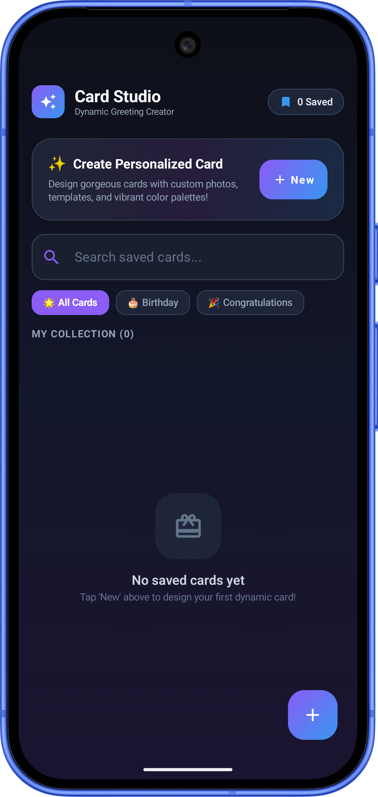
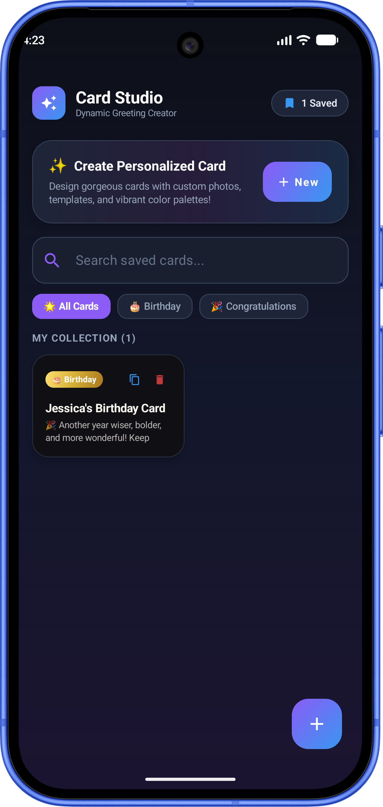
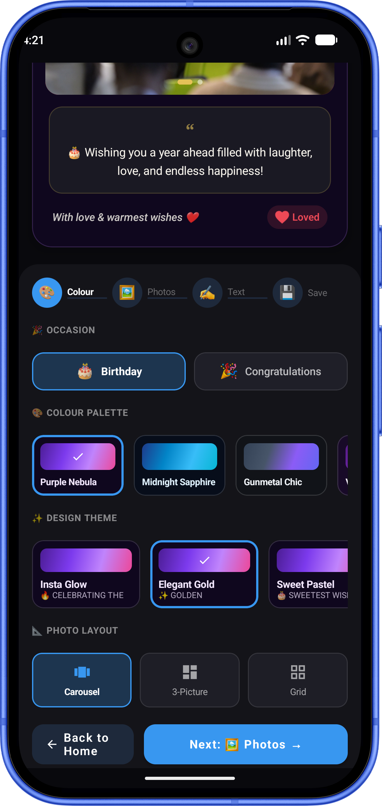
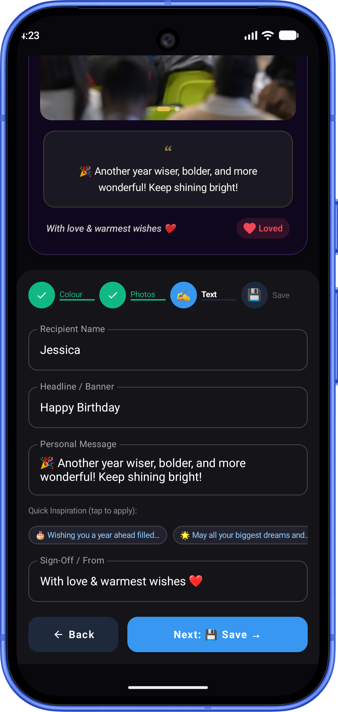
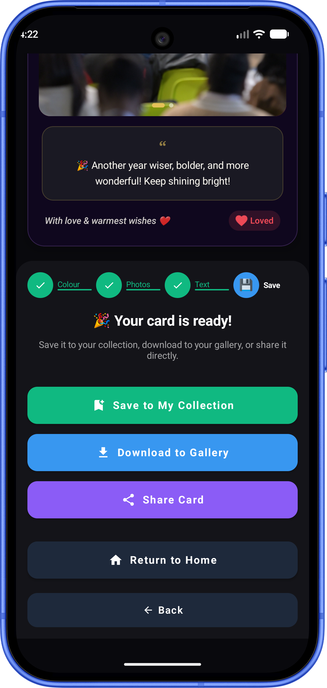
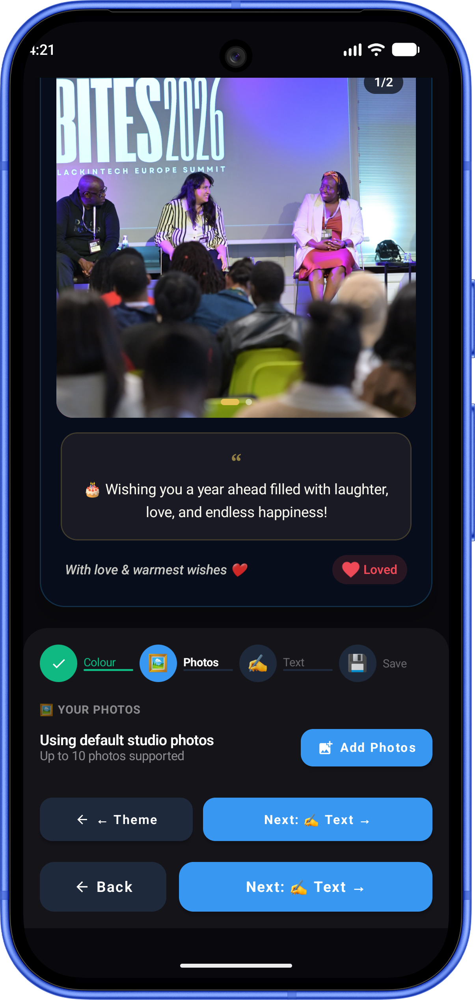
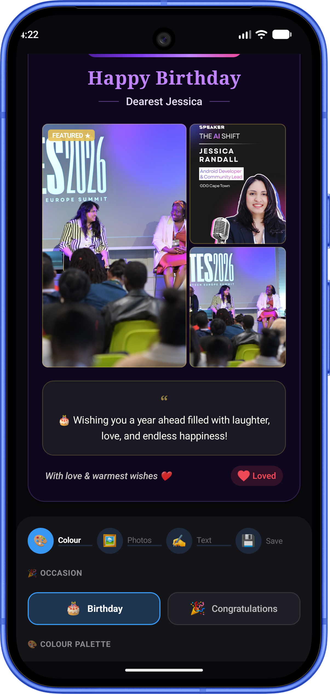
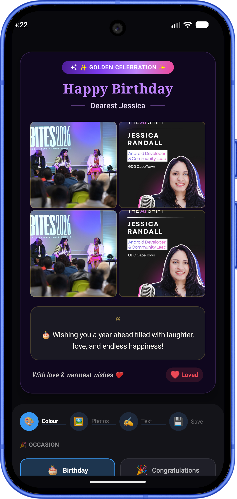
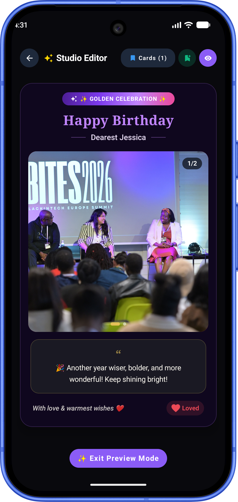

# 🎨 Card Studio — Greeting Card App

<p align="center">
  
</p>

<p align="center">
  <strong>A modern, interactive Android greeting card creator built with Kotlin and Jetpack Compose.</strong>
</p>

<p align="center">
  <a href="https://kotlinlang.org"></a>
  <a href="https://developer.android.com/jetpack/compose"></a>
  <a href="https://developer.android.com/studio/releases/gradle-plugin"></a>
  <a href="https://developer.android.com/about/versions/16"></a>
  <a href="https://developer.android.com/topic/libraries/architecture/room"></a>
  <a href="LICENSE"></a>
</p>

---

## 📖 Overview

**Card Studio** empowers users to create personalized, high-quality digital greeting cards for **Birthdays** 🎂 and **Congratulations** 🎉. With dark aesthetic themes, hand-crafted gradient color palettes, flexible photo collage layouts, interactive animated GIF stickers, and quick message inspiration, building a customized card is effortless and fun.

Cards are persisted locally via **Jetpack Room** and can be exported as high-resolution PNG images to the device gallery or shared directly using the Android Share Sheet.

---

## ✨ Key Features

### 🏠 Home Gallery & Collection Management
- **My Cards Grid** — Browse all saved cards in a responsive two-column grid layout with cover previews and quick metadata.
- **Search & Filter** — Instantly search saved cards by title, recipient, headline, or message, or filter by category (`Birthday` or `Congratulations`).
- **Quick Card Actions** — Edit existing cards, duplicate templates with one tap, or delete cards with persistent Room DB synchronization.
- **Interactive Call to Action** — Animated gradient trigger button to jump straight into creating a new card.

### 🪄 4-Step Guided Card Wizard
Card creation is structured into four intuitive steps:

| Step | Panel | Key Capabilities |
| :--- | :--- | :--- |
| 🎨 **1. Colour & Theme** | Theme & Layout | Select category (Birthday / Congrats), choose curated color palettes, template styles, and photo layout modes. |
| 🖼️ **2. Photos & GIFs** | Media & Stickers | Select photos from gallery, add animated GIF stickers (Party Popper, Cake, Sparkles, Hearts, or custom device GIFs), drag to reposition, resize, or delete. |
| ✍️ **3. Message** | Text & Inspiration | Enter recipient name, custom headline, sign-off, and write messages with quick-select inspiration chips. |
| 💾 **4. Save & Share** | Export & Finish | Save to Room database, export lossless PNG images to gallery, or share directly via the system share sheet. |

---

## 🎨 Design & Layout System

### 🌈 Curated Dark Color Palettes
Six custom gradient-enhanced dark color palettes:

- 🌌 **Purple Nebula** — Deep violet background with neon purple & magenta accents
- 💎 **Midnight Sapphire** — Dark ocean blue with cyan glow
- ⚔️ **Gunmetal Chic** — Dark slate grey with electric purple accents
- 🔮 **Velvet Violet** — Rich deep violet with bright magenta highlights
- 🛡️ **Slate Steel** — Dark navy slate with sky blue highlights
- 🌊 **Ocean Abyss** — Deep teal container with glowing cyan accents

### 📸 Instagram & Pinterest Layout Modes
- **Carousel** — Interactive swipeable Instagram-style multi-photo post with pagination dots.
- **3-Picture Collage** — Asymmetric Pinterest-style collage with hero feature image and stacked side items.
- **Grid** — Sleek equal-ratio photo grid with rounded corners and clean borders.

### 💖 Animated GIF Stickers
- Integrated GIF decoding powered by Coil GIF extension.
- Built-in celebratory sticker catalog (Party Popper, Birthday Cake, Sparkles, Confetti, Hearts, etc.).
- Custom GIF upload support from device storage.
- Drag-to-move, scale (+ / - controls), and deletion overlay controls directly on the card canvas.

---

## 📸 App Screenshots

### Home & Saved Collection
<p align="center">
  
  &nbsp;&nbsp;&nbsp;&nbsp;
  
</p>

### 4-Step Card Wizard
<p align="center">
  
  &nbsp;&nbsp;
  
  &nbsp;&nbsp;
  
</p>

### Layout Modes & Preview
<p align="center">
  
  &nbsp;
  
  &nbsp;
  
  &nbsp;
  
</p>

---

## 🏗️ Technical Architecture & Project Structure

Card Studio follows modern Android development principles with **Unidirectional Data Flow (UDF)**, Kotlin Coroutines, and Jetpack Compose state management.

```
Card Studio
├── app/
│   ├── src/
│   │   ├── main/
│   │   │   ├── java/com/starchild13/greetingcard/
│   │   │   │   ├── MainActivity.kt                # Top-level Activity & screen router
│   │   │   │   ├── data/
│   │   │   │   │   ├── GreetingCardEntity.kt      # Room entity definition
│   │   │   │   │   ├── GreetingCardDao.kt         # Reactive Flow Room DAO interface
│   │   │   │   │   └── GreetingCardDatabase.kt    # Room SQLite database singleton
│   │   │   │   ├── model/
│   │   │   │   │   └── GreetingCardModels.kt      # Domain models, catalogs, palettes, stickers
│   │   │   │   ├── ui/
│   │   │   │   │   ├── HomeScreen.kt              # Home screen gallery, search, and grid
│   │   │   │   │   ├── CardScreen.kt              # Main studio editor screen
│   │   │   │   │   ├── components/
│   │   │   │   │   │   ├── CardWizard.kt          # 4-step guided card builder
│   │   │   │   │   │   ├── SavedCardsSheet.kt     # Saved cards grid view
│   │   │   │   │   │   ├── PhotoCarousel.kt       # Swipeable photo carousel
│   │   │   │   │   │   ├── PhotoGrid.kt           # Equal aspect-ratio photo grid
│   │   │   │   │   │   ├── ThreePictureCollage.kt # Asymmetric 3-picture collage
│   │   │   │   │   │   ├── ActionBar.kt           # Top bar navigation & action controls
│   │   │   │   │   │   ├── CardControls.kt        # Editor control panels
│   │   │   │   │   │   └── Header.kt              # Top header banner layout
│   │   │   │   │   └── theme/                     # Compose Material theme & colors
│   │   │   │   └── util/
│   │   │   │       └── CardExporter.kt            # MediaStore export & FileProvider sharing
│   │   │   └── AndroidManifest.xml
│   │   └── androidTest/ & test/                    # Unit and Instrumented integration tests
│   └── build.gradle
├── gradle/
│   └── libs.versions.toml                          # Centralized Gradle Version Catalog
└── build.gradle
```

---

## 🛠️ Tech Stack & Dependencies

| Component | Library / Tool | Description |
| :--- | :--- | :--- |
| **Language** | [Kotlin 2.4](https://kotlinlang.org) | Modern concise programming language |
| **UI Framework** | [Jetpack Compose 1.12](https://developer.android.com/jetpack/compose) | Declarative UI toolkit |
| **Design System** | [Compose Material 2](https://developer.android.com/jetpack/compose/designsystems/material) | Material Design components & extended icons |
| **Image Loading** | [Coil 2.7](https://coil-kt.github.io/coil/) | Kotlin-first image loader with GIF decoding (`coil-gif`) |
| **Persistence** | [Room 2.8](https://developer.android.com/training/data-storage/room) | SQLite object mapping with Kotlin Coroutines Flow |
| **Code Generation** | [KSP 2.3](https://kotlinlang.org/docs/ksp-overview.html) | High-performance Kotlin Symbol Processing |
| **Build Tooling** | [AGP 9.5](https://developer.android.com/studio/releases/gradle-plugin) | Android Gradle Plugin with Gradle Version Catalog |

---

## 📋 Requirements

| Requirement | Minimum / Target |
| :--- | :--- |
| **Minimum SDK** | API 26 (Android 8.0 Oreo) |
| **Target SDK** | API 37 |
| **Compile SDK** | API 37 |
| **JDK Version** | Java 17 |
| **Android Studio** | Ladybug (2024.2.1) or newer |

---

## 🚀 Getting Started

### 1. Clone the repository
```bash
git clone https://github.com/Starchild13/Greeting-Card.git
cd Greeting-Card
```

### 2. Open in Android Studio
1. Launch **Android Studio**.
2. Select **Open** and choose the `Greeting-Card` directory.
3. Allow Gradle to sync dependencies automatically.

### 3. Build & Run
Connect an Android physical device or start an Emulator running **Android 8.0 (API 26)** or higher and click **Run** (▶️).

---

## 🎮 How to Build & Customise a Card

1. **Launch Studio** — Tap **✨ Create New Card** on the Home screen.
2. **Step 1: Theme & Layout** — Select your occasion category (Birthday or Congratulations), choose a dark color palette, template theme, and layout mode (Carousel, 3-Picture, or Grid).
3. **Step 2: Media & Stickers** — Upload photos from your gallery and add animated GIF stickers. Drag, resize, or delete stickers directly on the preview.
4. **Step 3: Message** — Type your recipient's name, custom headline, personal message (or choose a suggested inspiration prompt), and sign-off.
5. **Step 4: Save & Share** — Tap **Save to Collection** to keep it in your local Room database, **Download** to save PNG to your device gallery, or **Share** to send via messaging apps.

---

## 🗄️ Database Schema

Cards are saved locally in SQLite using Room database entity mapping:

```kotlin
@Entity(tableName = "greeting_cards")
data class GreetingCardEntity(
    @PrimaryKey(autoGenerate = true)
    val id: Int = 0,
    val title: String,
    val recipientName: String,
    val headline: String,
    val message: String,
    val signOff: String,
    val category: String,       // "BIRTHDAY" | "CONGRATULATIONS"
    val templateId: String,
    val paletteId: String,
    val layoutMode: String,     // "CAROUSEL" | "THREE_PICTURE" | "GRID"
    val photoUrisCsv: String,   // Comma-separated content URIs
    val gifStickerId: String,   // Main GIF identifier
    val placedGifsCsv: String,  // Serialized sticker position & scale metadata
    val likeCount: Int = 0,
    val createdAt: Long = System.currentTimeMillis()
)
```

---

## 📄 License

```
MIT License

Copyright (c) 2024 Jessica Randall

Permission is hereby granted, free of charge, to any person obtaining a copy
of this software and associated documentation files (the "Software"), to deal
in the Software without restriction, including without limitation the rights
to use, copy, modify, merge, publish, distribute, sublicense, and/or sell
copies of the Software, and to permit persons to whom the Software is
furnished to do so, subject to the following conditions:

The above copyright notice and this permission notice shall be included in all
copies or substantial portions of the Software.

THE SOFTWARE IS PROVIDED "AS IS", WITHOUT WARRANTY OF ANY KIND, EXPRESS OR
IMPLIED, INCLUDING BUT NOT LIMITED TO THE WARRANTIES OF MERCHANTABILITY,
FITNESS FOR A PARTICULAR PURPOSE AND NONINFRINGEMENT. IN NO EVENT SHALL THE
AUTHORS OR COPYRIGHT HOLDERS BE LIABLE FOR ANY CLAIM, DAMAGES OR OTHER
LIABILITY, WHETHER IN AN ACTION OF CONTRACT, TORT OR OTHERWISE, ARISING FROM,
OUT OF OR IN CONNECTION WITH THE SOFTWARE OR THE USE OR OTHER DEALINGS IN THE
SOFTWARE.
```

---

## 👩‍💻 Author

**Jessica Randall** — [@Starchild13](https://github.com/Starchild13)
